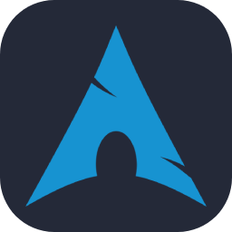
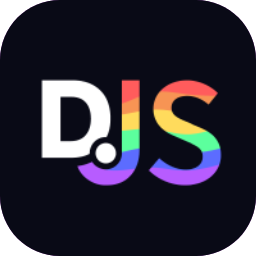
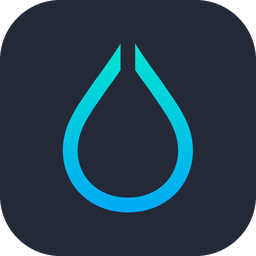
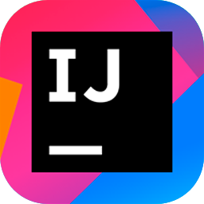
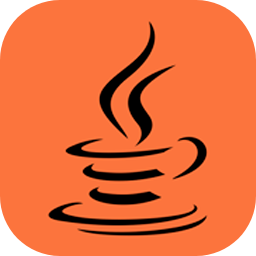
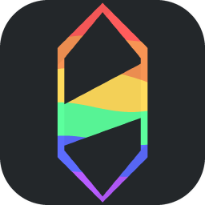
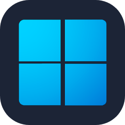

<div align="center" style="text-align: center">
	<h1>¡Hi <a href="https://github.com/ashl3ycodes#"></a> I'm Ashley!</h1>
	<h3>A random girl on the internet and a passionate to code.</h3>
	<h6>(Software Engineering student, monster energy addict, gamer, eepy princess, and your f̶r̶i̶e̶n̶d̶l̶y coding witch)</h6>
</div>

<div align="right" style="text-align: right">
	<!-- https://github.com/lowlighter/metrics -->
	<a href="https://github.com/ashl3ycodes#">
		
	<!-- </a>
	<a href="https://github.com/ashl3ycodes#">
		
	</a> -->
</div>

```ts
import Universe from "/root/Simulations/Universe";
const {Systems} = Universe.Systems.Galaxies.MilkyWay;
const {Human} = Systems.Solar.Planets.Earth.Entities;

const Ashley: InstanceType<typeof Human> = {
 name: "Ashley",
 pronouns: "She/Her",
 nicknames: ["ashl3y", "ashl3ycodes", "Anshurii"],
 likes: ["Code", "Sleep", "Monster Energy"],
 dislikes: ["Sleep", "Bugs", "Competitiveness"],
 skills: ["Backend Development", "Frontend Development",
  "Bot Development","Scripting & Automation"
 ],
 stack: {
  webDevelopment: {
   frontEnd: ["CSS", "HTML", "JavaScript"],
   backEnd: ["TypeScript", "Node.js"]
  },
  softwareDevelopment: ["C", "C++", "Lua", "Python",
   "Bash", "Java", "Go", "C#", "QML", "TypeScript"
  ],
  botDevelopment: ["Discord.js", "Sapphire",
   "TypeScript", "Node.js", "SQLite", "MongoDB"
  ]
 },
 tools: {
  ides: ["Neovim", "IntelliJ IDEA"],
  os: {
   linux: {
    OS: "Arch Linux",
    compositor: "Hyprland"
   },
   windows: "Windows 11"
  }
 },
 contact: {
  discord: {
   username: "ashl3ycodes"
  }
 }
};
```

<div align="center" style="display: block">
	<!-- https://github.com/tandpfun/skill-icons#readme -->
	<h3 align="center">Languages, technologies and tools that I usually use.</h3>
	
	
	
	
	
	
	
	
	
	
	
	
	
	
	
	
	
	
	
	
	
	
	
	
	
	
	
	
</div>

<div align="center" style="display: block">
	<!-- https://github.com/tandpfun/skill-icons#readme -->
	<h3 align="center">Of all those tools, these are the ones I use the most:</h3>
	
	
	
	
	
	
	
	
</div>

<div align="center" style="text-align: center">
	<!-- https://github.com/Ashutosh00710/github-readme-activity-graph -->
	<a href="https://github.com/ashl3ycodes#">
		
	</a>
</div>


